<div align="center">


# Hermex for Android

**A native Android control plane for your self-hosted Hermes agent.**<br />
Built for phones, tablets, foldables, and the Samsung Galaxy Trifold.

[](https://github.com/jcartu/hermex/actions/workflows/android-ci.yml)
[](android/README.md)
[](android/README.md)
[](android/README.md)
[](#verification)
[](LICENSE)

[Android guide](android/README.md) · [Upstream iOS project](https://github.com/uzairansaruzi/hermex) · [Hermes WebUI](https://github.com/nesquena/hermes-webui) · [Android issues](https://github.com/jcartu/hermex/issues)

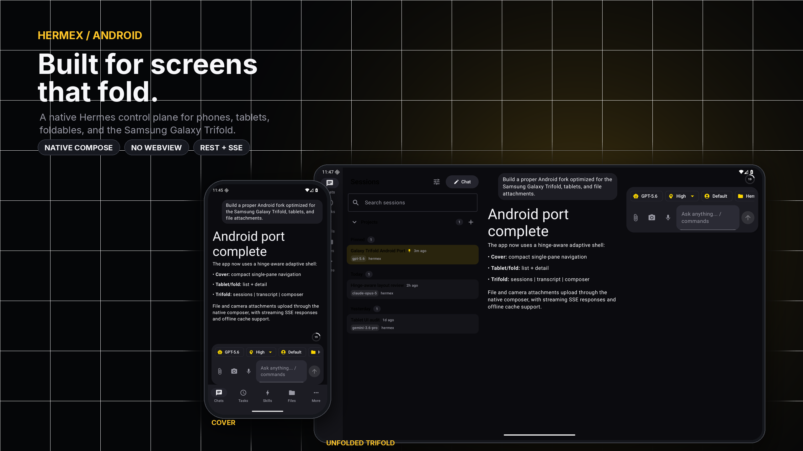

</div>

## What this is

Hermex for Android is a **native Kotlin + Jetpack Compose client** for a
self-hosted [hermes-webui](https://github.com/nesquena/hermes-webui) server.
It lets you start work, watch an agent run, steer it, approve actions, inspect
files, manage scheduled jobs, and recover context without sitting at the
machine hosting the agent.

The server remains the compute plane. The Android device is the control,
review, and continuity surface.

This is deliberately not:

- a WebView around the browser UI;
- a hosted relay or cloud account;
- a copy of the Hermes Python runtime inside Android;
- a phone-only layout stretched across a tablet.

The app talks directly to the server you configure over REST and Server-Sent
Events. There is no analytics SDK, ad SDK, third-party relay, or subscription.

## Why this fork exists

The excellent upstream [Hermex](https://github.com/uzairansaruzi/hermex)
project is a native SwiftUI iPhone application. Its API contract, product
thinking, and iOS implementation are the foundation of this repository.

Android needed more than a mechanical port. Foldables and large screens change
how an agent client should work: the session list should remain visible, the
transcript should keep its place, the composer should not cover the work, and a
third panel should carry useful context instead of empty padding.

This fork therefore keeps the original iOS project intact and adds a separate,
native `android/` application with four goals:

1. **Native Android interaction.** Compose UI, Android file and camera pickers,
   voice dictation, Android Keystore, DataStore, predictive back, and proper
   lifecycle handling.
2. **First-class adaptive layouts.** Compact cover displays, ordinary phones,
   tablets, dual-fold devices, and triple-fold devices each get a layout shaped
   for their usable space.
3. **Operational parity.** Chat, sessions, projects, models, tasks, skills,
   files, memory, insights, settings, approvals, and recovery are real working
   surfaces—not screenshots around an unfinished core.
4. **Upstream-compatible wire behavior.** The Android client decodes the same
   tolerant response models and targets the same pinned hermes-webui contract
   as the iOS app. It does not invent server APIs.

| | Upstream Hermex | This fork |
|---|---|---|
| Primary client | Native SwiftUI for iPhone | Native Compose for Android |
| Original code | Preserved in `HermesMobile/` | Added in `android/` |
| Large screens | iPhone portrait/landscape | Phone, tablet, fold, trifold, multi-window |
| Distribution | App Store / TestFlight | Source build + signed local APK workflow |
| Relationship | Source project and product foundation | Proper GitHub fork with explicit attribution |

## One app, every posture

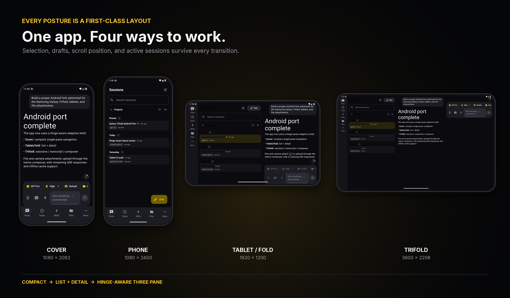

The layout is selected from the **actual window and hinge state**, not from a
hard-coded portrait/landscape switch.

| Form factor | Navigation | Working layout |
|---|---|---|
| Cover / compact phone | Bottom navigation | One focused surface; system back returns from chat to sessions |
| Standard phone | Bottom navigation | Full-screen list or detail with native transitions |
| Tablet / opened fold | Navigation rail | Persistent list + detail |
| Galaxy Trifold | Navigation rail | Hinge-aligned list + detail + context/composer |
| Half-open / flex posture | Rail or compact navigation | Controls avoid hinge occlusion; session/draft state remains live |
| Multi-window | Width-driven | Reflows without restarting the active task |

Selection, draft text, staged attachments, scroll position, active session, and
stream recovery survive cover-to-inner-display transitions. App-level
navigation uses a `SavedStateHandle`; feature state lives in ViewModels rather
than in a disposable layout branch.

## The third pane is functional

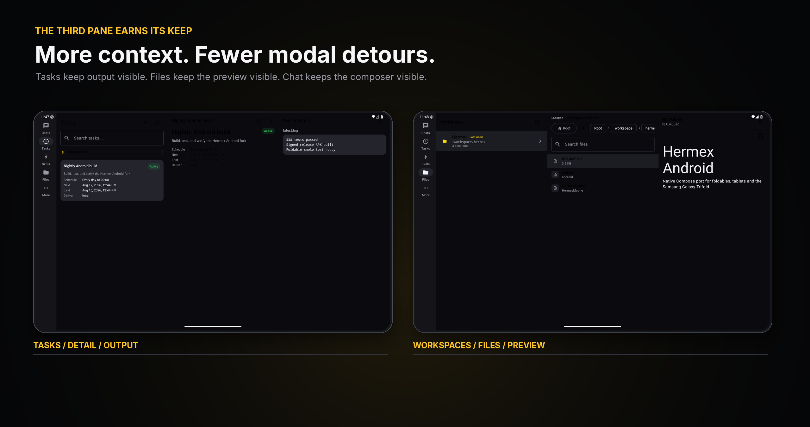

On a trifold, the app does not merely widen two columns:

- **Chat:** sessions | transcript | composer and run controls
- **Tasks:** task list | task detail and actions | recent output
- **Skills:** skill list | rendered skill | linked file
- **Files:** workspaces | directory contents | file preview

Pane boundaries are derived from `androidx.window` folding features and aligned
with physical hinge centers. On devices without reported hinges, the same
system falls back to measured window width.

## What was added

### Native Android foundation

- Kotlin 2.4 and Jetpack Compose with Material 3 Adaptive behavior
- Android 8 / API 26 minimum; target and compile SDK 37
- edge-to-edge system UI, predictive back, resizable activity, and multi-window
- Android Keystore encryption for the saved server password
- persistent cookie jar for hermes-webui authentication
- DataStore-backed settings, model favorites, and recents
- file-backed offline session and transcript cache
- tolerant `kotlinx.serialization` models matching the iOS wire behavior
- OkHttp REST client plus a native SSE stream client
- no WebView and no embedded browser runtime

### Chat and run control

- token-by-token streaming with replay-aware reconnect
- reasoning blocks, tool calls, tool results, status, title, and metering events
- markdown, code blocks, copy actions, and monospace math fallback
- stop and steer while a run is active
- approval and clarification sheets with expiry handling
- optimistic sending with rollback when a request fails
- active-run status and context-window indicator
- transcript pagination and offline cache fallback
- response speed, timestamps, RTL chat layout, code wrapping, and card display settings

### Composer

- model picker grouped by provider
- model favorites and recent selections
- reasoning effort and reasoning visibility
- profile switching and workspace selection
- slash-command autocomplete from local, server, and skill commands
- persistent goal controls
- Android document picker with multiple file types
- camera capture through the native activity-result API
- attachment previews, removal, upload state, and a 20 MB client-side limit
- Android speech recognition for voice dictation
- layout that separates from the transcript on a trifold

### Sessions and projects

- local title/model/workspace search plus debounced server content search
- pinned, recent, scheduled, archived, CLI-imported, and delegated-session visibility
- rename, pin, archive, restore, duplicate/branch, move, delete, and export
- project create, rename, delete, color, filtering, and session counts
- swipe actions on compact screens and contextual actions on larger screens
- cached read-only recovery when the server is unreachable

### Tasks and skills

- scheduled task list, detail, status, timing, delivery, model/profile metadata, and output
- create, edit, run now, pause, resume, and delete cron jobs
- delivery options, toast behavior, validation, and server-rejection handling
- skill grouping, search, tags, enable/disable, markdown content, and linked files
- optimistic skill toggles with rollback on failure

### Files, memory, and insights

- workspace roots, breadcrumbs, directory navigation, search, and back stack
- text/markdown preview, line numbers, wrapping, copy, image loading, and binary detection
- cookie-authenticated raw file previews through the shared OkHttp client
- memory, user profile, agent soul, and project-context sections
- usage timeframes, token totals, estimated cost, daily usage chart, model share, and top sessions

### Settings and onboarding

- connection test, health probe, auth-status detection, password and passwordless servers
- Tailscale-focused setup guidance
- system/light/dark theme and selectable accent colors
- chat, haptics, section visibility, default model/profile, providers, server info, and logout
- one shared authentication state machine across shell, onboarding, and settings

## Screenshots

All screenshots below are real Android 16 emulator captures running the Compose
application against a disposable local hermes-webui-compatible fixture.

<table>
  <tr>
    <th>Compact cover — active chat</th>
    <th>Standard phone — sessions</th>
  </tr>
  <tr>
    <td>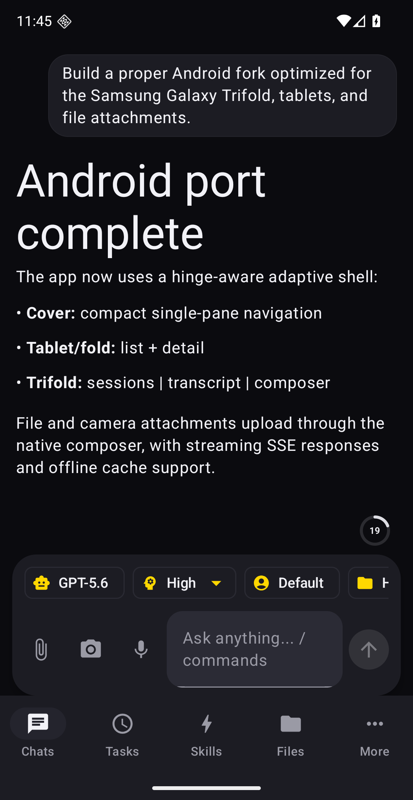</td>
    <td>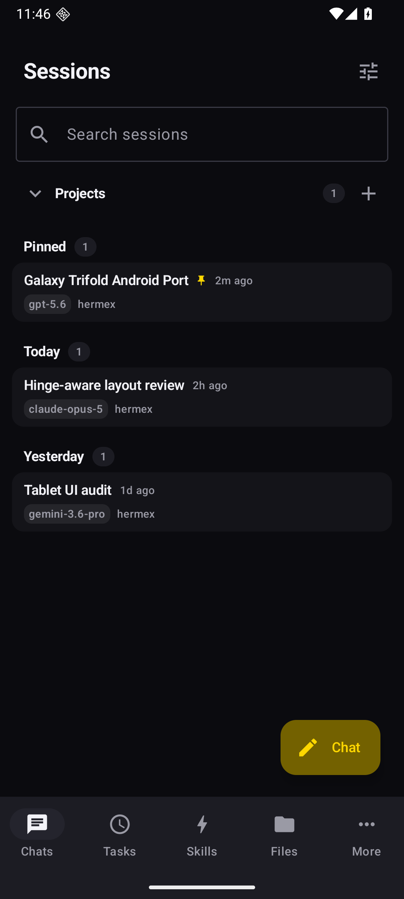</td>
  </tr>
</table>

<table>
  <tr>
    <th>Opened fold — list + chat</th>
    <th>Standard tablet — list + detail</th>
  </tr>
  <tr>
    <td>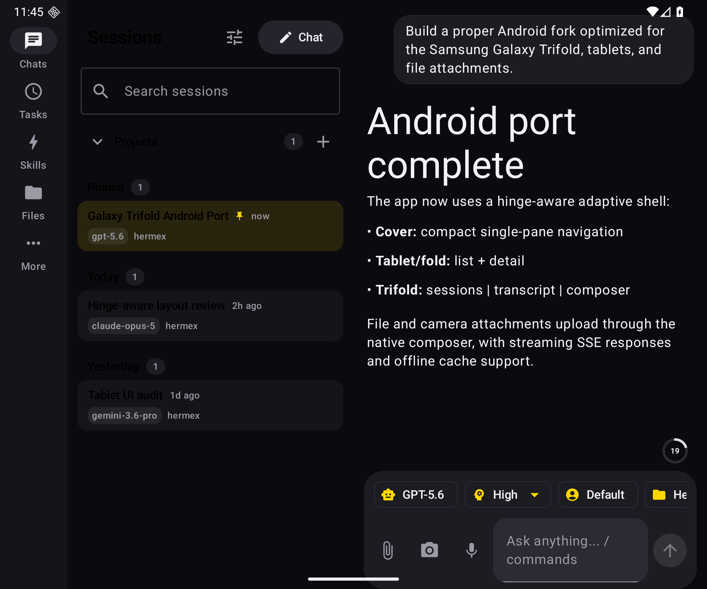</td>
    <td>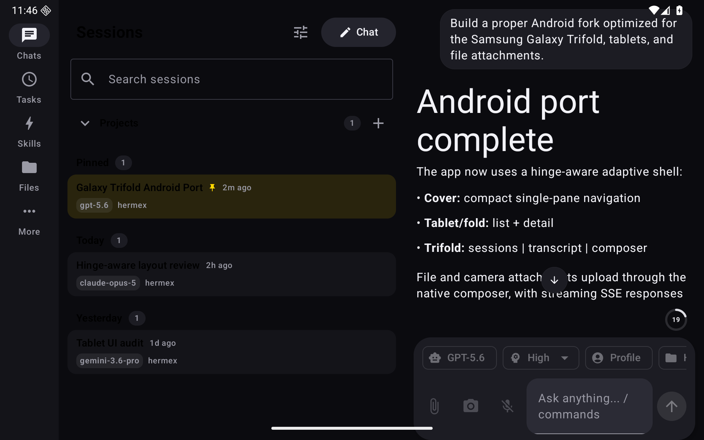</td>
  </tr>
</table>

### Fully unfolded trifold

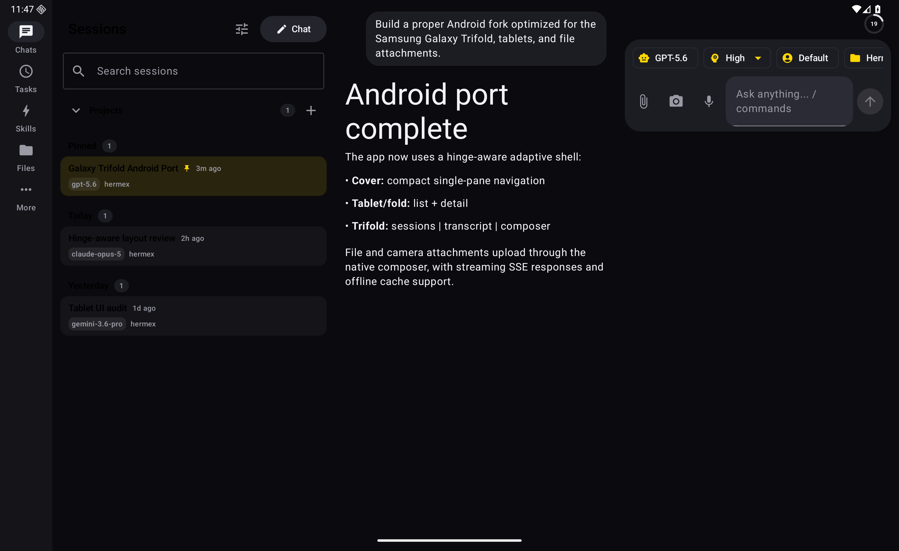

<details>
<summary><strong>More trifold surfaces</strong></summary>

#### Tasks: list, detail, output

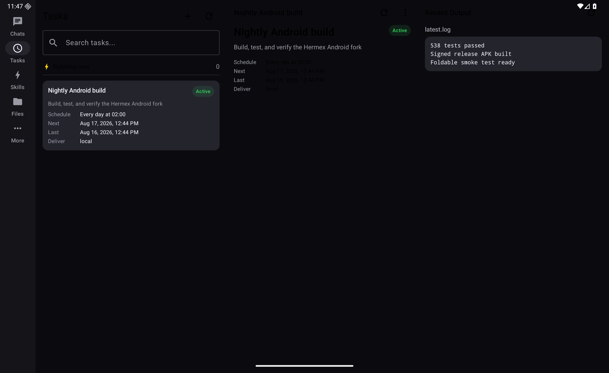

#### Files: workspaces, directory, preview

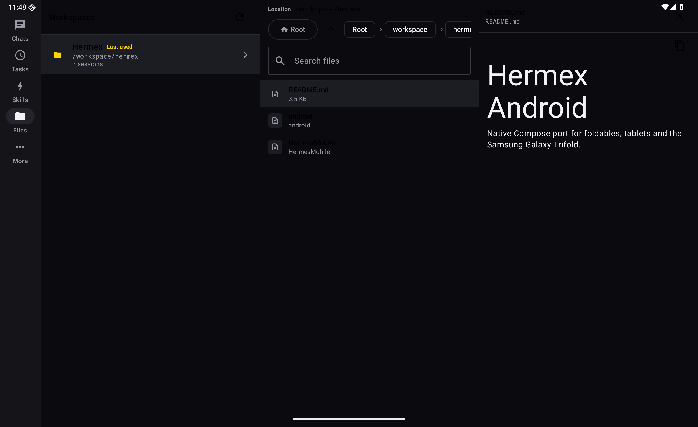

#### Half-open continuity

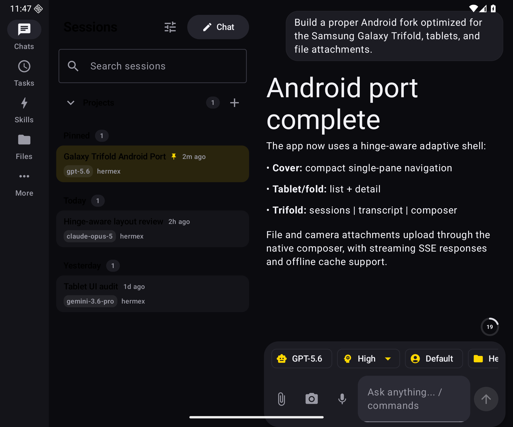

</details>

## Feature map

| Surface | Android implementation |
|---|---|
| Connect | URL normalization, health/auth probes, password and passwordless login |
| Chat | REST start + native SSE stream, reconnect, stop, steer, reasoning, tools |
| Attachments | Android file picker, camera, previews, upload, transcript rendering |
| Voice | Android `SpeechRecognizer` dictation with graceful capability fallback |
| Sessions | Browse, content search, cache, pin/archive/branch/move/delete/export |
| Projects | Create, rename, delete, filter, colors, session counts |
| Models | Provider groups, search, custom models, favorites, recents |
| Profiles | Active/default profile, switching, model/workspace inheritance |
| Tasks | Full cron lifecycle plus detail, delivery options, output |
| Skills | Browse, search, render, linked files, enable/disable |
| Files | Workspace roots, directories, text/markdown/image previews |
| Memory | Memory, user, soul, and project context |
| Insights | Tokens, cost, timeframes, models, daily chart, top sessions |
| Settings | Appearance, chat behavior, providers, defaults, visibility, logout |
| Offline | Cached session list and transcripts with connectivity-aware fallback |
| Foldables | Width + hinge-aware one/two/three-pane layouts and state continuity |

## Architecture

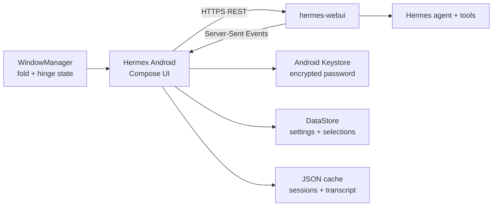

The Android project is intentionally a single application module. Features are
organized by product surface; shared wire models and networking stay separate
from Compose UI.

```text
android/app/src/main/java/io/github/jcartu/hermex/
├── core/          # crypto, prefs, cookies, logging
├── data/          # offline cache
├── model/         # tolerant server models
├── net/           # endpoints, REST, SSE, errors
├── ui/adaptive/   # fold state and hinge-aligned panes
└── ui/feature/    # chat, sessions, tasks, skills, files, memory, insights…
```

## Privacy and security

- The app connects only to the server URL you enter.
- The server password is encrypted by a key held in Android Keystore.
- Session cookies persist locally; logout clears the local session.
- Native requests deliberately omit browser `Origin` and `Referer` headers,
  matching hermes-webui's supported non-browser CSRF path.
- Unknown JSON fields are ignored; malformed optional fields degrade instead of
  crashing the UI.
- Redirected custom headers are stripped when the redirect crosses origin.
- Signing keys, passwords, local SDK paths, APKs, and build output are ignored
  by Git.

You remain responsible for securing and updating your self-hosted server.
HTTPS through Tailscale Serve, Cloudflare Tunnel, or a reverse proxy is the
recommended transport.

## Getting started

### 1. Run hermes-webui

Install and start [hermes-webui](https://github.com/nesquena/hermes-webui) on a
machine you control. Configure a strong `HERMES_WEBUI_PASSWORD` whenever the
server is reachable beyond loopback.

### 2. Make it reachable

Use real HTTPS through Tailscale Serve, Cloudflare Tunnel, or your reverse
proxy. Plain HTTP remains useful for a trusted LAN or emulator development.

### 3. Build and install Android

Requirements: JDK 21 and Android SDK platform 37.

```bash
git clone https://github.com/jcartu/hermex.git
cd hermex/android
./gradlew testDebugUnitTest
./gradlew assembleDebug
adb install -r app/build/outputs/apk/debug/app-debug.apk
```

For a signed local release:

```bash
./gradlew assembleRelease
```

Signing credentials live in a gitignored `android/keystore.properties`; see
[`android/README.md`](android/README.md) for the exact format and toolchain.

## Verification

The Android delivery is checked at three levels:

| Gate | Evidence |
|---|---|
| JVM behavior | 538 unit and contract tests across 49 suites |
| Release | `assembleRelease` succeeds; local APK verified with Signature Scheme v2 |
| Surface | Android 16 Pixel Fold emulator: CLOSED, HALF_OPENED, OPENED, standard phone/tablet widths, and simulated 3600×2208 trifold |
| Native flows | Authentication restore, session continuity, document picker, chat, task detail/output, file preview, memory/insights/settings |
| Cloud | [Android CI](https://github.com/jcartu/hermex/actions/workflows/android-ci.yml) runs tests and uploads an unsigned release APK |

Run the same local gate:

```bash
cd android
./gradlew testDebugUnitTest assembleRelease
```

## Current scope boundaries

The Android app does not currently port Kanban boards, Git panels,
TTS/transcription endpoints, an Android share target, push notifications, or
iOS-specific Live Activities and App Intents. They are intentionally omitted,
not represented by non-functional placeholders.

## Upstream and attribution

This repository is a proper fork of
[`uzairansaruzi/hermex`](https://github.com/uzairansaruzi/hermex), created by
[Uzair Ansar](https://github.com/uzairansaruzi). The upstream SwiftUI app,
product specification, test approach, artwork, and API-contract research made
this Android work possible.

- Upstream website: [hermexapp.com](https://hermexapp.com)
- Upstream iOS app: [App Store](https://apps.apple.com/app/hermex/id6767006319)
- Upstream contributing guide: [`CONTRIBUTING.md`](CONTRIBUTING.md)
- Android implementation guide: [`android/README.md`](android/README.md)
- Tested server pin: [`UPSTREAM_TESTED_SHA`](UPSTREAM_TESTED_SHA)

Android-specific issues and pull requests belong in this fork. Changes to the
iOS product should be proposed upstream.

## License

MIT — see [`LICENSE`](LICENSE).

Hermex is an independent client and is not affiliated with the upstream
hermes-webui project. Apple, the Apple logo, and App Store are trademarks of
Apple Inc. Android, Jetpack, and Google Play are trademarks of Google LLC.
