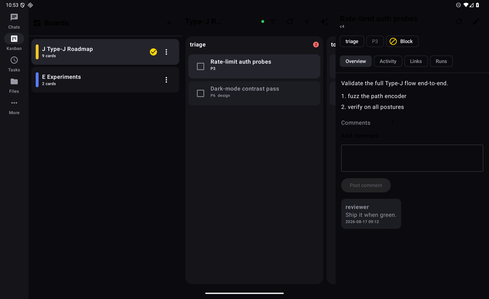
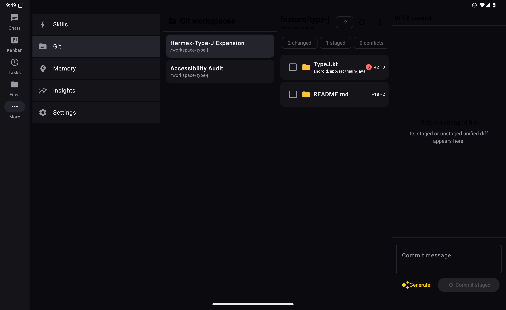
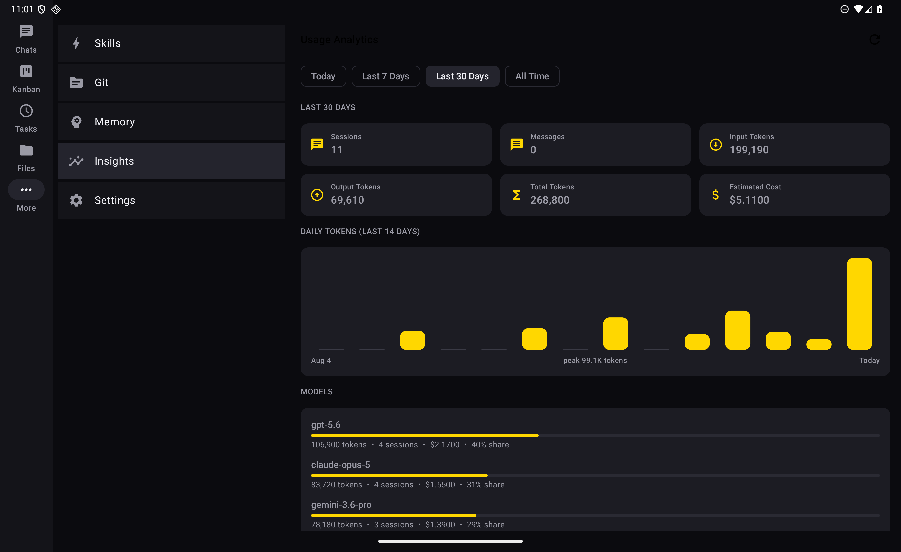
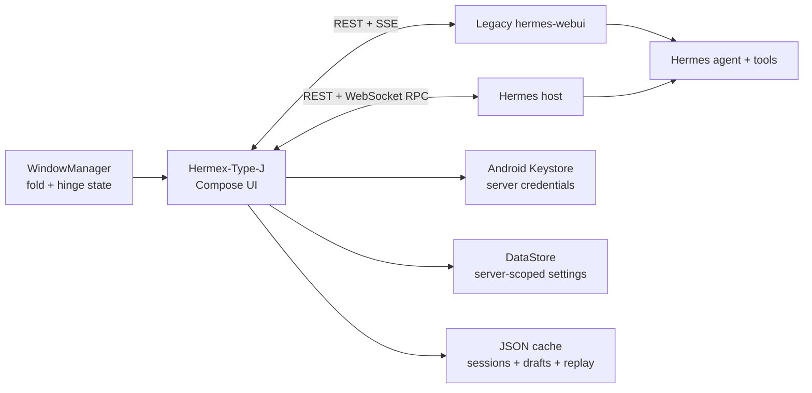

<div align="center">


# Hermex-Type-J

**A native Android control plane for your self-hosted Hermes agent.**<br />
Built for phones, tablets, foldables, and the Samsung Galaxy Trifold. Tokyo Night by default.

[](https://github.com/jcartu/Hermex-Type-J/actions/workflows/android-ci.yml)
[](android/README.md)
[](android/README.md)
[](android/README.md)
[](LICENSE)

[Android guide](android/README.md) · [Upstream iOS project](https://github.com/uzairansaruzi/hermex) · [Hermes WebUI](https://github.com/nesquena/hermes-webui) · [Type-J issues](https://github.com/jcartu/Hermex-Type-J/issues)


</div>

## What this is

Hermex-Type-J is a **native Kotlin + Jetpack Compose client** for a self-hosted
[Hermes](https://github.com/NousResearch/hermes-agent) host, with continuing
support for legacy [hermes-webui](https://github.com/nesquena/hermes-webui) servers.
Start work, follow a run, steer it, answer requests, inspect files, manage jobs,
and recover context without sitting at the machine hosting the agent.

The server remains the compute plane. The Android device is the control,
review, and continuity surface.

This is deliberately not:

- a WebView around the browser UI;
- a hosted relay or cloud account;
- a copy of the Hermes Python runtime inside Android;
- a phone-only layout stretched across a tablet.

The app talks directly to your configured servers over REST and WebSocket RPC
(Hermes) or Server-Sent Events (WebUI). There is no analytics SDK, ad SDK,
third-party relay, or subscription.

## What this fork adds over upstream Hermex

Upstream [Hermex](https://github.com/uzairansaruzi/hermex) supplies the iOS
application and behavioral reference. Type-J brings those workflows to native
Android while preserving its hinge-aware layouts and platform integrations.

| Surface | Upstream Hermex | Hermex-Type-J |
|---|---|---|
| Platform | SwiftUI on iOS | Kotlin + Compose on Android 8+ |
| Layout | Native iOS layouts | Hinge-aware one/two/three-pane layouts |
| Servers | Hermes hosts and legacy WebUI | Both kinds, with isolated credentials and local state |
| Kanban and Git | Native board and workspace tools | Adaptive boards, all-file review, and confirmed mutations |
| Sharing and links | Share extension and App Intents | Durable ACTION_SEND inbox, deep links, launcher shortcuts |
| Run updates | Live Activities and optional APNs relay | Foreground monitoring and private local notifications |
| Proxy credentials | Server-scoped custom headers | Keystore-encrypted, per-origin, redirect-safe headers |
| Voice | Host speech and device dictation | Host speech/transcription, native recording, Android TTS fallback |
| Appearance | Upstream themes | Tokyo Night by default; Classic and explicit Light/System options |
| Distribution | App Store / TestFlight | Source build, signed local APK, unsigned Android CI artifact |

The upstream history is retained, including the 1.6–1.9 releases and the
October 22, 2026 upstream 2.0 development snapshot. Platform-specific differences
are described below rather than presented as blanket feature parity.

## Why this fork exists

The upstream project's API contract, product thinking, and iOS implementation
are the foundation of this repository. But Android needed more than a
mechanical port: foldables and large screens change how an agent client should
work — the session list stays visible, the transcript keeps its place, the
composer doesn't cover the work, and a third panel carries real context instead
of empty padding. Android's share intents, foreground services, shortcuts, and
Keystore provide native equivalents for the corresponding iOS integrations.

This fork keeps the original iOS project intact in `HermesMobile/` and adds a
separate native `android/` application:

1. **Native Android interaction.** Compose UI, Android file and camera pickers,
   Android Keystore, DataStore, predictive back, proper lifecycle handling.
2. **First-class adaptive layouts.** Compact cover displays, phones, tablets,
   dual-fold and triple-fold devices each get a layout shaped for their space.
3. **Current upstream workflows.** Chat, sessions, Tasks, Kanban, Files, Git,
   Skills, Memory, and Usage retain native controls rather than embedding WebUI.
4. **Upstream-compatible wire behavior.** Tolerant decoding of the same models;
   no invented server APIs.

## One app, every posture


The layout is selected from the **actual window and hinge state**, not from a
hard-coded portrait/landscape switch.

| Form factor | Navigation | Working layout |
|---|---|---|
| Cover / compact phone | Bottom navigation | One focused surface; system back returns from chat to sessions |
| Standard phone | Bottom navigation | Full-screen list or detail with native transitions |
| Tablet / opened fold | Navigation rail | Persistent list + detail |
| Galaxy Trifold | Navigation rail | Hinge-aligned list + detail + context/composer |
| Half-open / flex posture | Rail or compact navigation | Controls avoid hinge occlusion; session/draft state remains live |
| Multi-window | Width-driven | Reflows without restarting the active task |

Selection, draft text, staged attachments, scroll position, active session, and
stream recovery survive cover-to-inner-display transitions. App-level
navigation uses a `SavedStateHandle`; feature state lives in ViewModels rather
than in a disposable layout branch.

## The third pane is functional


On a trifold, the app does not merely widen two columns:

- **Chat:** sessions | transcript | composer and run controls
- **Tasks:** task list | task detail and actions | recent output
- **Skills:** skill list | rendered skill | linked file
- **Files:** workspaces | directory contents | file preview

Pane boundaries are derived from `androidx.window` folding features and aligned
with physical hinge centers. On devices without reported hinges, the same
system falls back to measured window width.

## What was added

### Native Android foundation

- Kotlin 2.4 and Jetpack Compose with Material 3 Adaptive behavior
- Android 8 / API 26 minimum; target and compile SDK 37
- edge-to-edge system UI, predictive back, resizable activity, and multi-window
- Android Keystore encryption for server registries, passwords, OAuth refresh tokens, and custom headers
- isolated authentication and local state for multiple saved servers
- DataStore-backed settings, model favorites, and recents
- file-backed offline session and transcript cache
- tolerant `kotlinx.serialization` models matching the iOS wire behavior
- OkHttp REST, WebSocket RPC, and replay-aware SSE clients
- native app screens; a sandboxed in-app web viewer only for ordinary external links

### Direct Hermes hosts

- dashboard-first password, browser-PKCE, or explicitly warned open-host sign-in
- native session streaming, approvals/questions, sudo/secret requests, and media
- model, Profile, reasoning, personality, and Fast controls from the host catalog
- plans, turn outcomes, delegated-worker inspection, goals, BTW, and background work
- host updates from Settings with confirmation and restart/receipt reconciliation

### Chat and run control

- word-boundary streaming with replay-aware reconnect and offline waiting
- compact reasoning/tool activity and folded completed turns with elapsed time
- Markdown, file-edit diffs, copy actions, media previews, and math fallback
- stop, steer, queue, or stop-and-send while a run is active
- answerable approval/question cards with confirmed-clear and reconnect handling
- optimistic sending with rollback when a request fails
- active-run status and context-window indicator
- transcript pagination and offline cache fallback
- response speed, timestamps, RTL chat layout, code wrapping, and card display settings
- durable composer drafts and partial-stream snapshots across process recreation
- selection-to-question and keyboard recall of the last user message
- opt-in foreground monitoring for both WebUI and direct-Hermes runs, with
  source-bound completion and pending-request notifications

### Composer

- model picker grouped by provider
- model favorites and recent selections
- session-scoped reasoning effort and a combined model/effort control
- Profile and working-folder selection
- caret-aware slash/skill autocomplete and workspace-file chips
- persistent goal controls
- Android document picker with multiple file types
- camera capture through the native activity-result API
- attachment previews, removal, upload state, and a 20 MB client-side limit
- Android speech recognition for voice dictation
- layout that separates from the transcript on a trifold

### Sessions and projects

- order-independent multi-word search plus server-side content excerpts
- pinned, unread, scheduled, archived, and active-session state indicators
- rename, pin, archive, restore, duplicate/branch, move, delete, and export
- project create, rename, delete, color, filtering, and session counts
- swipe actions on compact screens and contextual actions on larger screens
- cached read-only recovery when the server is unreachable

### Bots and moving from WebUI

- Hermes home switches between retained Bots and Sessions views
- bot creation, editing, capabilities/instructions, faces/photos, sections, and search
- regular chat with bot identity, rules, and mentions; group rooms and thread replies
- scan-before-copy WebUI migration with Profile choices, resumable progress,
  draft-conflict preservation, and old-link forwarding
- source-server removal is a separate explicit action, never an automatic migration step

### Tasks and skills

- task agenda with filters, recent runs, per-task history, and output
- create, edit, run now, pause, resume, and delete cron jobs
- delivery options, toast behavior, validation, and server-rejection handling
- skill grouping, search, tags, enable/disable, markdown content, and linked files
- optimistic skill toggles with rollback on failure

### Kanban boards

- boards with columns, counts, active-board switching, create/edit/archive
- cards with status, priority, assignee, tenant, skills, workspace, and staleness badges
- card detail with comments, activity events, dependency links, and run history
- create/edit/move/block/unblock, bulk actions, and dispatcher dry-run/execute
- worker-log tailing and lifecycle-bound live event reconciliation (monotonic cursor)
- three-pane boards | columns | detail on a trifold

### Git workspaces

- session-scoped workspace status, branch, ahead/behind, and conflict badges
- per-file staged/unstaged unified diffs with binary and size-cap handling
- stage, unstage, and explicitly confirmed discard
- fetch, pull, push and checkout with dirty-tree guards; WebUI retains stash-checkout
- generated commit messages and staged or selected-path commits
- no force-push and no unconfirmed destructive action anywhere
- Hermes fetch/pull/new-branch actions appear only when companion capabilities permit them

### Android platform integration

- ACTION_SEND / SEND_MULTIPLE / PROCESS_TEXT share target with a durable
  app-private inbox (survives process death; acknowledged only after staging)
- deep links (`hermex-type-j://` and legacy `hermes-agent://`) to new chat,
  sessions, Kanban boards/cards, and Git workspaces, persisted through onboarding
- static launcher shortcuts for New Chat, Kanban, and Git Workspaces
- opt-in foreground monitoring of active runs with private ongoing and
  completion notifications, cancel action, and status/replay recovery
- encrypted per-origin custom request headers for authenticated reverse proxies
  (masked editor, duplicate/injection/protected-header validation, cross-origin
  redirect stripping, never logged, Keystore-encrypted at rest)
- Android Keystore, DataStore, predictive back, edge-to-edge, and multi-window

### Voice

- native AAC voice notes with mic permission, timer, and duration/size guards
- server transcription with audio preserved when STT is unavailable
- assistant **Listen** action: server neural TTS for ≤5,000 characters with
  silent Android TextToSpeech fallback and markdown-safe text normalization

### Files, memory, and Usage

- lazy workspace trees, file-type icons, folder navigation, and source highlighting
- Markdown/image previews, line numbers, wrapping, copy/share, and PDF viewing
- authenticated, bounded file downloads; document previews up to 25 MB
- memory and soul editing on Hermes; existing read-only WebUI panels remain available
- usage windows, token/cost totals, model breakdowns, top sessions, and provider limits

### Settings and onboarding

- connection test, health probe, auth-status detection, password and passwordless servers
- Tailscale-focused setup guidance
- Tokyo Night dark by default, explicit System/Light/Dark modes, and selectable accents
- chat, haptics, section visibility, default model/profile, providers, server info, and logout
- one shared authentication state machine across shell, onboarding, and settings

## Screenshots

All screenshots below are real Android 16 emulator captures running the Compose
application against a disposable local hermes-webui-compatible fixture.

<table>
  <tr>
    <th>Compact cover — active chat</th>
    <th>Standard phone — sessions</th>
  </tr>
  <tr>
    <td></td>
    <td></td>
  </tr>
</table>

<table>
  <tr>
    <th>Opened fold — list + chat</th>
    <th>Standard tablet — list + detail</th>
  </tr>
  <tr>
    <td></td>
    <td></td>
  </tr>
</table>

### Fully unfolded trifold


<details>
<summary><strong>More trifold surfaces</strong></summary>

#### Tasks: list, detail, output


#### Kanban: boards, columns, detail



#### Git: workspaces, status, diff and commit



#### Files: workspaces, directory, preview


#### Insights: usage analytics



#### Half-open continuity


</details>

## Feature map

| Surface | Android implementation |
|---|---|
| Connect | URL normalization, health/auth probes, password and passwordless login |
| Chat | REST start + native SSE stream, reconnect, stop, steer, reasoning, tools |
| Attachments | Android file picker, camera, previews, upload, transcript rendering |
| Voice | Android `SpeechRecognizer` dictation with graceful capability fallback |
| Sessions | Browse, content search, cache, pin/archive/branch/move/delete/export |
| Projects | Create, rename, delete, filter, colors, session counts |
| Models | Provider groups, search, custom models, favorites, recents |
| Profiles | Active/default profile, switching, model/workspace inheritance |
| Tasks | Full cron lifecycle plus detail, delivery options, output |
| Kanban | Boards, columns, card detail, bulk actions, dispatcher, live events |
| Git | Status, diffs, stage/commit, guarded remotes, stash-checkout |
| Share target | Durable text/file inbox routed into a new-chat composer |
| Voice | Voice notes, server transcription, Listen with device TTS fallback |
| Background | Foreground run monitor with private progress/completion notifications |
| Deep links | Type-J + legacy schemes to chat, sessions, Kanban, Git; launcher shortcuts |
| Custom headers | Encrypted per-origin proxy headers with redirect stripping |
| Skills | Browse, search, render, linked files, enable/disable |
| Files | Workspace roots, directories, text/markdown/image previews |
| Memory | Memory, user, soul, and project context |
| Usage | Tokens, cost, timeframes, models, daily chart, top sessions, provider limits |
| Settings | Appearance, chat behavior, providers, defaults, visibility, logout |
| Offline | Cached session list and transcripts with connectivity-aware fallback |
| Foldables | Width + hinge-aware one/two/three-pane layouts and state continuity |

## Architecture



The Android project is intentionally a single application module. Features are
organized by product surface; shared wire models and networking stay separate
from Compose UI.

```text
android/app/src/main/java/io/github/jcartu/hermex/
├── core/          # crypto, prefs, cookies, logging
├── data/          # server-scoped cache, drafts, and stream snapshots
├── model/         # tolerant server models
├── net/           # WebUI REST/SSE plus Hermes REST/RPC
├── ui/adaptive/   # fold state and hinge-aligned panes
└── ui/feature/    # chat, sessions, tasks, skills, files, memory, insights…
```

## Privacy and security

- The app connects only to the server URL you enter.
- Passwords, saved Hermes sign-in records, and registry data are encrypted with Android Keystore.
- Saved credentials, headers, cache, drafts, and selections stay with their owning server.
- Legacy WebUI retains upstream's host-scoped cookie jar: different ports on the
  same hostname can share a login cookie. Use distinct hostnames for independent
  WebUI instances; direct-Hermes connections have their own cookie jars.
- Native requests deliberately omit browser `Origin` and `Referer` headers,
  matching hermes-webui's supported non-browser CSRF path.
- Unknown JSON fields are ignored; malformed optional fields degrade instead of
  crashing the UI.
- Redirected custom headers are stripped when the redirect crosses origin.
- Signing keys, passwords, local SDK paths, APKs, and build output are ignored
  by Git.

You remain responsible for securing and updating your self-hosted server.
HTTPS through Tailscale Serve, Cloudflare Tunnel, or a reverse proxy is the
recommended transport.

## Getting started

### 1. Run a Hermes host or legacy WebUI

Run [Hermes](https://github.com/NousResearch/hermes-agent)'s dashboard on your
own machine. Configure its supported sign-in provider, persistent signing secret,
and public URL as described in [`DEVELOPMENT.md`](DEVELOPMENT.md#hermes-host-setup).
Legacy [hermes-webui](https://github.com/nesquena/hermes-webui) remains supported;
set a strong `HERMES_WEBUI_PASSWORD` when exposing it beyond loopback.

### 2. Make it reachable

Use real HTTPS through Tailscale Serve, Cloudflare Tunnel, or your reverse
proxy. Plain HTTP remains useful for a trusted LAN or emulator development.

### 3. Build and install Android

Requirements: JDK 21 and Android SDK platform 37.

```bash
git clone https://github.com/jcartu/Hermex-Type-J.git
cd Hermex-Type-J/android
./gradlew testDebugUnitTest
./gradlew assembleDebug
adb install -r app/build/outputs/apk/debug/app-debug.apk
```

For a signed local release:

```bash
./gradlew assembleRelease
```

Signing credentials live in a gitignored `android/keystore.properties`; see
[`android/README.md`](android/README.md) for the exact format and toolchain.

## Verification

The Android gates are reproducible; use the current CI run rather than a
hardcoded test count from a previous release.

| Gate | Check |
|---|---|
| Behavior | JVM regression suite for models, protocols, state transitions, drafts, and recovery |
| Static analysis | Android Lint on the integrated build |
| Packaging | Debug/release builds; verify a locally signed APK before distribution |
| Native surfaces | Emulator sign-in, sessions, settings, sharing, and folded/unfolded continuity |
| Cloud | [Android CI](https://github.com/jcartu/Hermex-Type-J/actions/workflows/android-ci.yml) runs tests and uploads an unsigned APK |

JVM and Robolectric tests do not replace on-device checks: Android's runtime
and rendering behavior differ from the host JVM. Never treat a past monkey
run or an upstream iOS result as verification of the current Android build.

Run the same local gate:

```bash
cd android
./gradlew testDebugUnitTest lintDebug assembleDebug assembleRelease
```

## Current scope boundaries

The upstream notification relay currently targets APNs, not Android. Type-J's
local run notifications and foreground monitoring are not remote push delivery
while the app is stopped. iOS Live Activities/App Intents map to Android ongoing
notifications and shortcuts; general documents use Android viewers rather than
Quick Look. A separate TTS-engine voice picker is not provided.

## Upstream and attribution

This repository is a proper fork of
[`uzairansaruzi/hermex`](https://github.com/uzairansaruzi/hermex), created by
[Uzair Ansar](https://github.com/uzairansaruzi). The upstream SwiftUI app,
product specification, test approach, artwork, and API-contract research made
this Android work possible.

- Upstream website: [hermexapp.com](https://hermexapp.com)
- Upstream iOS app: [App Store](https://apps.apple.com/app/hermex/id6767006319)
- Upstream contributing guide: [`CONTRIBUTING.md`](CONTRIBUTING.md)
- Android implementation guide: [`android/README.md`](android/README.md)
- WebUI compatibility pin: [`UPSTREAM_TESTED_SHA`](UPSTREAM_TESTED_SHA)
- Hermes compatibility pin: [`HERMES_AGENT_TESTED_SHA`](HERMES_AGENT_TESTED_SHA)

Android-specific issues and pull requests belong in this fork. Changes to the
iOS product should be proposed upstream.

### Supporters

Hermex is funded by its members. Thank you.

**Patrons:** Robin Edwards

**Members:** Aaron Kaufer

**Founding members:** James Cross · Alexey

<sub>Updated monthly from [Buy Me a Coffee](https://buymeacoffee.com/callmeuzi/membership). Members who join anonymously aren't listed. Email [uzairansar@gmail.com](mailto:uzairansar@gmail.com) to be added or removed.</sub>

## License

MIT — see [`LICENSE`](LICENSE).

Tokyo Night colors follow [enkia's Tokyo Night](https://github.com/enkia/tokyo-night-vscode-theme)
and [folke's Tokyonight](https://github.com/folke/tokyonight.nvim). Upstream's
workspace file icons are from Pierre's `@pierre/trees` (Apache-2.0) with additions
from T3 Code (MIT); Type-J uses Android vector counterparts and the same type mapping.

Hermex is an independent client and is not affiliated with the upstream
hermes-webui project. Apple, the Apple logo, and App Store are trademarks of
Apple Inc. Android, Jetpack, and Google Play are trademarks of Google LLC.
